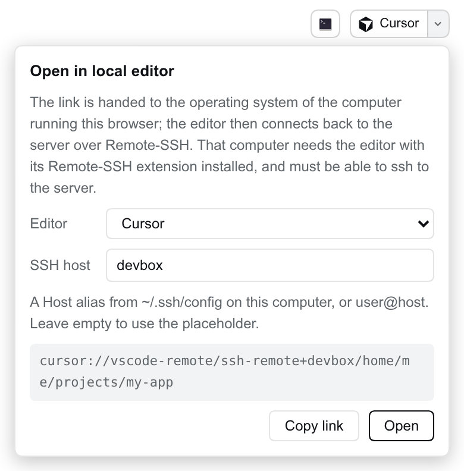

# dsh-remote-editor

A [DeepSeek Harness (DSH)](https://github.com/deepseek-ai/deepseek-harness) Web plugin that opens the current session's workspace in **Cursor, VS Code, VS Code Insiders or Windsurf on the computer running your browser**, connected to the DSH server over Remote-SSH.

[中文文档](README.zh.md)



## Why

DSH's built-in "Open In..." button launches applications on the machine that runs the DSH server. That works when the browser and the server share a desktop. When you reach DSH from another computer (a devbox, a VM, a lab server), the button is hidden because the server has no display, and if it were shown, the editor window would open on the server where you cannot see it.

A web page cannot start applications on your computer. It can follow a link whose scheme your operating system hands to an installed app. Cursor and the VS Code family register such schemes, and they accept Remote-SSH folder links:

```
cursor://vscode-remote/ssh-remote+<host><absolute path>
vscode://vscode-remote/ssh-remote+<host><absolute path>
```

This plugin puts that link on the session header, built from the session's working directory.

## What you get

- A button next to the official "Open In..." control, showing the chosen editor's logo. Clicking it opens the workspace in your local editor.
- A drop-down panel to choose the editor and the SSH host, preview the link, and copy it.
- The editor and host are stored in the browser's `localStorage`, because they describe your computer, not the server. Different computers can use different settings against the same DSH server.
- The default host is `<server account>@<address in the browser's location bar>`. Put an `~/.ssh/config` alias there instead when you need a specific key, port or jump host.
- English and Chinese UI, following the DSH language setting.

## Requirements

On the computer running the browser:

- The editor, with its Remote-SSH extension (Cursor and VS Code ship or offer it).
- Working `ssh` access to the DSH server under the host you configure.

The first time a browser follows a `cursor://` or `vscode://` link it asks whether to open the app; allow it. If clicking does nothing, the editor is not installed or did not register its URL scheme.

DSH `>=0.2.2-alpha.2 <0.3.0-0` (0.2.x, including its prereleases), Node `>=22.19`.

## Usage

Open any session. Click the button with the editor's logo in the top-right header to open the workspace; click the arrow beside it to change the editor or the SSH host.

## Install

```bash
# from npm
dsh plugin --profile web add dsh-remote-editor

# from GitHub
dsh plugin --profile web add github:Edison-A-N/dsh-remote-editor
```

The package ships its own bundle patch (`dsh.bundle.patch` + `cordis.patch.yml`), so the CLI and the Web UI's Plugins page load it in one step. Restart DSH, reload the page and open a session.

## How it works

- **Browser half** (`lib/client.js`): registers one entry in the `conversation.session.header.utilities` slot. It reads the session's `cwd` from the slot's `useSessions` prop, the same source the official button uses, and renders a plain `<a href="cursor://...">`. A real link keeps the click a user gesture, so browsers hand the scheme to the OS without navigating the page.
- **Server half** (`lib/index.js`): one `GET /plugins/remote-editor/api/info` route behind DSH's login check, returning the server account name for the default host. The server never launches anything.
- Hosts are limited to letters, digits and `. _ - @ : [ ]`, and each path segment is percent-encoded, so a host or path cannot break out of the link. Paths with `.` or `..` segments and hosts starting with `-` are refused.

## Development

```bash
pnpm install
pnpm run build   # bundles client/src into lib/client.js
pnpm test
```

`lib/client.js` is committed, because DSH loads it as-is; rebuild it in the same commit as any change under `client/src`.

Bug reports and pull requests are welcome on [GitHub](https://github.com/Edison-A-N/dsh-remote-editor/issues). Please include the DSH version, the browser and OS, and the link shown in the panel.

## License

[MIT](LICENSE). Editor logos are from [Simple Icons](https://simpleicons.org) (CC0-1.0); the names and logos are trademarks of their owners and are used only to identify the editor that a link opens.
