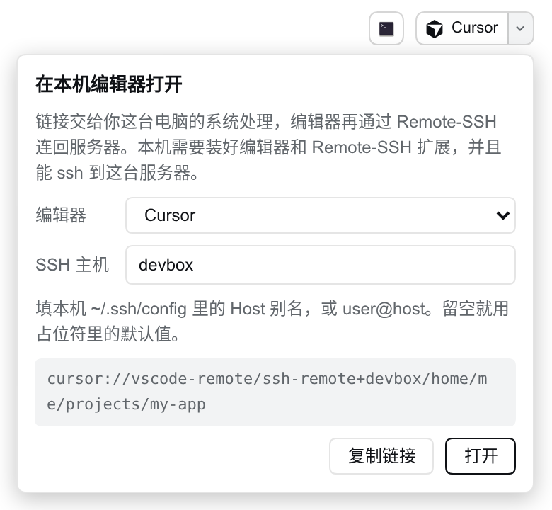

# dsh-remote-editor

[DeepSeek Harness（DSH）](https://github.com/deepseek-ai/deepseek-harness) 的 Web 插件。在会话右上角加一个按钮，用**你浏览器所在电脑上的** Cursor、VS Code、VS Code Insiders 或 Windsurf 打开当前会话的工作目录，编辑器通过 Remote-SSH 连到 DSH 服务器。

[English](README.md)



## 为什么要做

DSH 自带的「Open In...」按钮在 DSH 服务所在的机器上启动程序。浏览器和服务在同一台电脑上时没问题。从另一台电脑访问 DSH 时（开发机、虚拟机、实验室服务器），服务器没有图形桌面，按钮会隐藏；就算显示出来，编辑器也会开在服务器上，你看不到。

网页不能启动你电脑上的程序，但可以打开一个链接，由操作系统按协议转给本机装好的应用。Cursor 和 VS Code 一系都注册了这类协议，并且支持 Remote-SSH 目录链接：

```
cursor://vscode-remote/ssh-remote+<主机><绝对路径>
vscode://vscode-remote/ssh-remote+<主机><绝对路径>
```

插件用会话的工作目录拼出这个链接，放在会话头部。

## 功能

- 官方「Open In...」按钮旁边多一个按钮，显示所选编辑器的图标，点一下就在本机编辑器里打开工作目录。
- 点旁边的小箭头打开面板，可以选编辑器、改 SSH 主机、预览和复制链接。
- 编辑器和主机存在浏览器的 `localStorage` 里。它们描述的是你的电脑，不是服务器，所以不同电脑访问同一个 DSH 可以各用各的设置。
- 默认主机是 `<服务器账号>@<浏览器地址栏里的地址>`。需要指定密钥、端口或跳板机时，在面板里填本机 `~/.ssh/config` 的 Host 别名。
- 界面有中文和英文，跟随 DSH 的语言设置。

## 使用前提

浏览器所在的电脑上：

- 装好编辑器和它的 Remote-SSH 扩展（Cursor 和 VS Code 自带或可以直接安装）。
- 能用你填的主机 `ssh` 到 DSH 服务器。

浏览器第一次打开 `cursor://`、`vscode://` 链接时会弹窗询问是否打开应用，选允许。点了没反应，一般是本机没装这个编辑器，或者它没注册链接协议。

需要 DSH `>=0.2.2-alpha.2 <0.3.0-0`（0.2.x 及其预发布版），Node `>=22.19`。

## 使用

打开任意会话，点右上角带编辑器图标的按钮就能打开工作目录；点旁边的箭头可以换编辑器或改 SSH 主机。

## 安装

```bash
# 从 npm 安装
dsh plugin --profile web add dsh-remote-editor

# 从 GitHub 安装
dsh plugin --profile web add github:Edison-A-N/dsh-remote-editor
```

包里自带 bundle patch（`dsh.bundle.patch` 和 `cordis.patch.yml`），命令行和 Web 界面的插件页都能一步装好。装完重启 DSH，刷新页面，打开任意会话就能看到按钮。

## 实现

- **浏览器端**（`lib/client.js`）：在 `conversation.session.header.utilities` 槽位注册一个条目。工作目录取自槽位传入的 `useSessions` 里的会话 `cwd`，和官方按钮同源。按钮是一个普通的 `<a href="cursor://...">`：用真链接，点击才算用户手势，浏览器会把协议交给系统，页面本身不跳转。
- **服务端**（`lib/index.js`）：只有一个 `GET /plugins/remote-editor/api/info` 接口，受 DSH 登录校验保护，返回服务器账号名，用来生成默认主机。服务端不启动任何程序。
- 主机只允许字母、数字和 `. _ - @ : [ ]`，路径逐段做百分号编码，主机和路径都没法改写链接的其他部分。带 `.`、`..` 段的路径和以 `-` 开头的主机直接拒绝。

## 开发

```bash
pnpm install
pnpm run build   # 把 client/src 打包成 lib/client.js
pnpm test
```

DSH 直接加载 `lib/client.js`，所以它跟源码一起提交。改了 `client/src` 就重新构建，放在同一个提交里。

欢迎在 [GitHub](https://github.com/Edison-A-N/dsh-remote-editor/issues) 提问题和 PR。报问题时请附上 DSH 版本、浏览器和操作系统，以及面板里显示的链接。

## 许可证

[MIT](LICENSE)。编辑器图标来自 [Simple Icons](https://simpleicons.org)（CC0-1.0）。这些名称和图标是各自所有者的商标，这里只用来标明链接会打开哪个编辑器。
